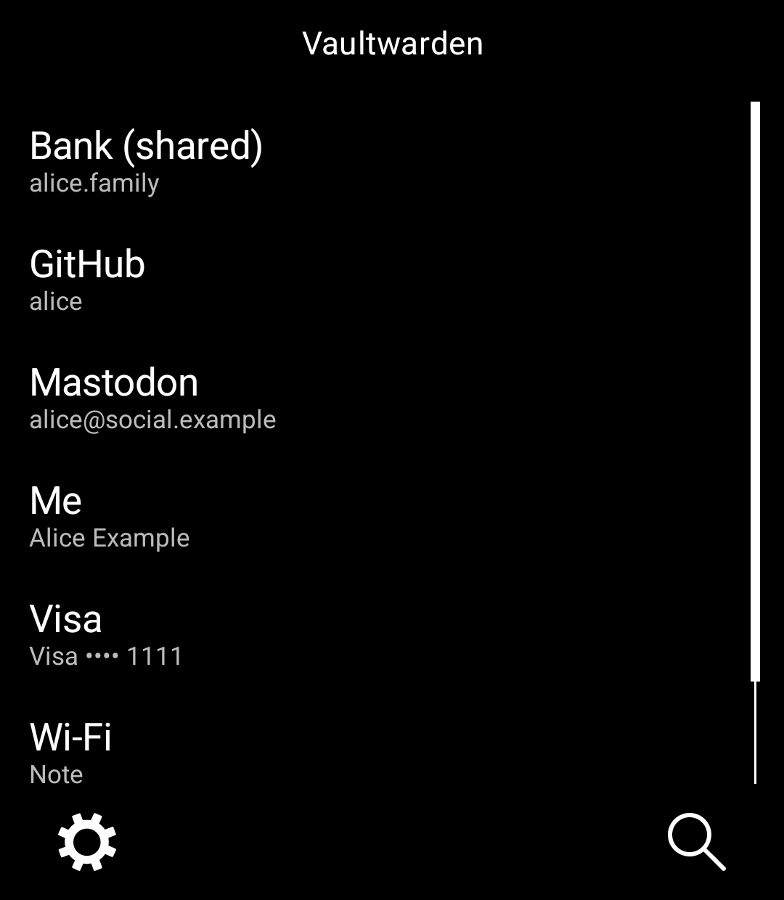
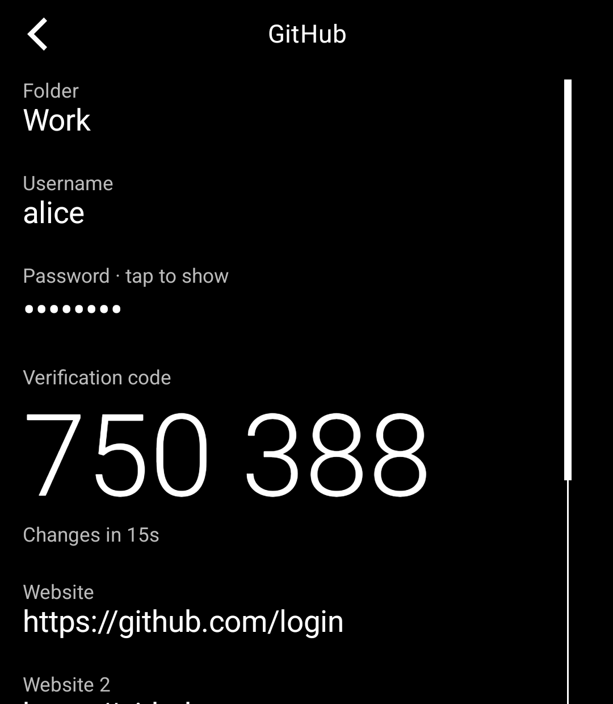
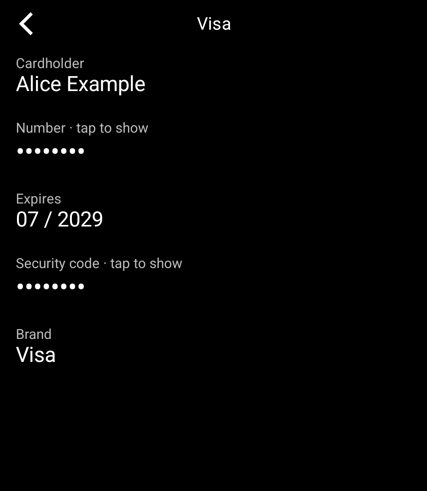
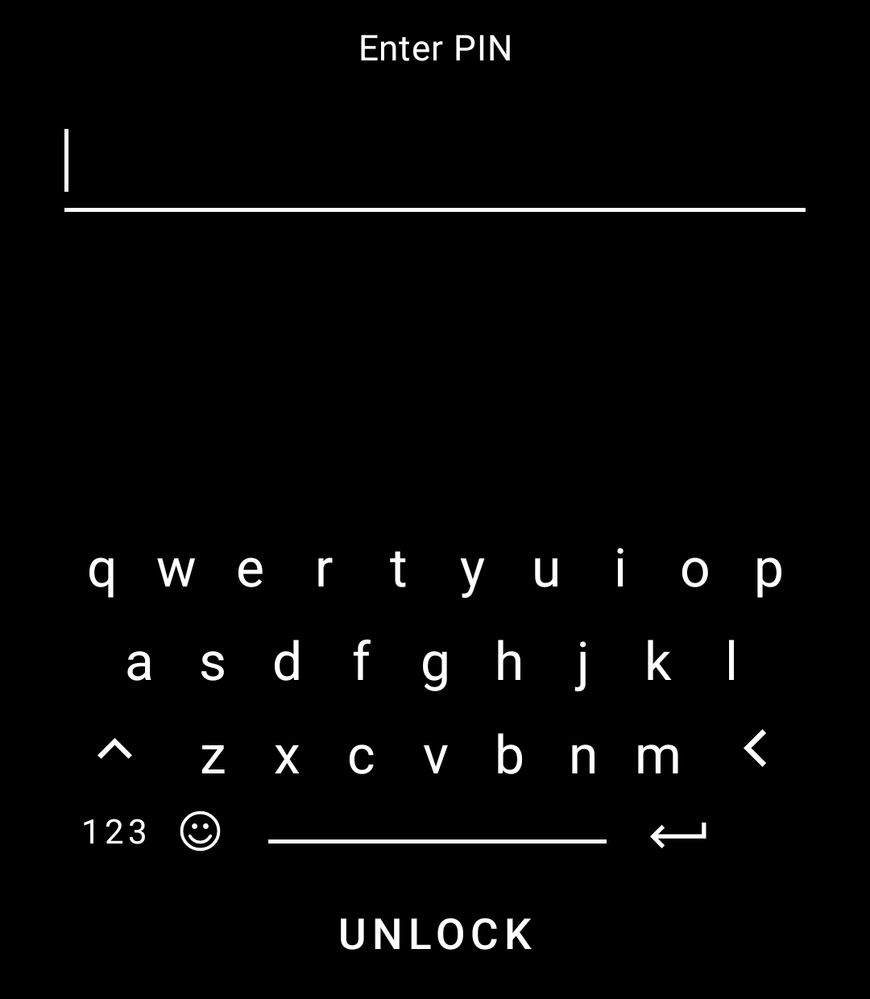

# Vaultwarden for the Light Phone III

An unofficial, read-only password manager for the Light Phone III for
[Vaultwarden](https://github.com/dani-garcia/vaultwarden) and self-hosted [Bitwarden](https://bitwarden.com) servers.
Built with the [Light SDK](https://github.com/lightphone/light-sdk).

- Look up logins, cards, identities and secure notes from your vault, including shared (organization) items
- See two-factor codes for logins that have them, with a countdown
- Passwords, card numbers and other secrets stay hidden until you tap them
- Search the vault
- Unlock with a PIN; the vault locks itself a minute after you leave the tool

  
  
  
  

The screenshots use a made-up test vault.

## How it works

Sign in once with your server address, email and master password. If your account uses two-factor login with an
authenticator app, you'll be asked for the code. Then choose a PIN for unlocking from then on.

The vault is decrypted on the phone, the same way the official Bitwarden apps do it; your master password and
decrypted items never leave it. After five wrong PINs the tool forgets the vault, and you sign in again with your
master password.

The tool is read-only: add and edit items on a computer or in the Bitwarden apps, and they sync to the phone.

Supported: Vaultwarden and self-hosted Bitwarden servers (including ones on your home network over plain
`http://`), PBKDF2 and Argon2id accounts, and authenticator-app two-factor login. Other two-factor methods (email
codes, security keys, Duo) aren't supported yet, and signing in to Bitwarden's own cloud hasn't been tested.

Tested with a self-hosted Vaultwarden, a test server built from Bitwarden's protocol and Bitwarden's published
crypto test vectors. Reports from other setups are welcome.

This project is not affiliated with Bitwarden or the Vaultwarden project.

## Install

You need JDK 21, the Android SDK and `adb`, and a Light Phone III you can sideload tools onto over ADB.

1. In `tool/lighttool.toml`, switch `serverPackage` to `"com.lightos"` (the committed value targets the LightOS
   emulator).
2. Build: `./gradlew :tool:assembleDebug`
3. Install: `adb install -r tool/build/outputs/apk/debug/tool-debug.apk`

To run it in the LightOS emulator instead, keep the committed `serverPackage` and build with
`./gradlew :tool:assembleDebug -DlightSdk.allowAltServerPackage=true`.

The tool's code is in [`tool/`](../tool). Everything else in this repository is the Light SDK (MIT licence); the
SDK's own README is [`README.md`](../README.md).
